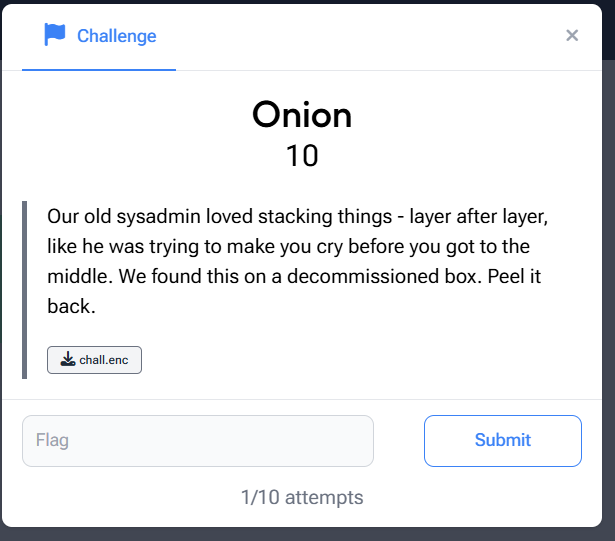
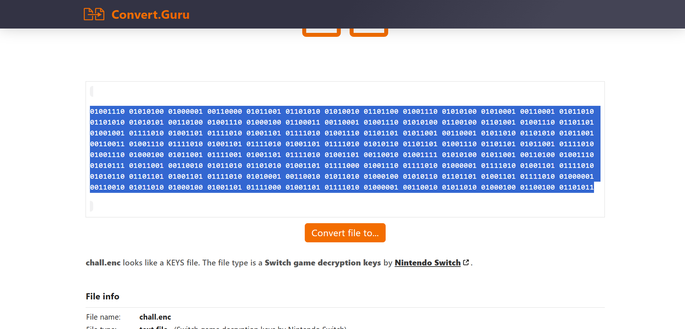
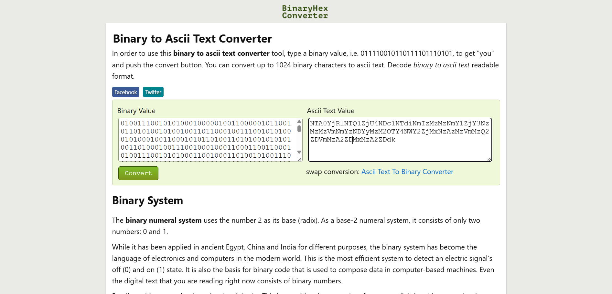
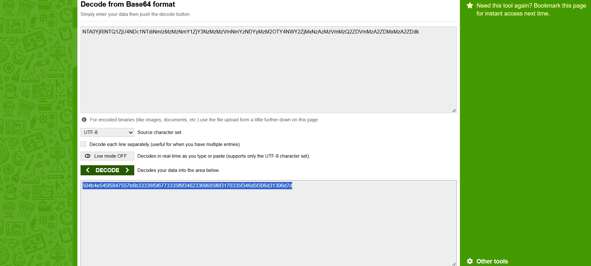
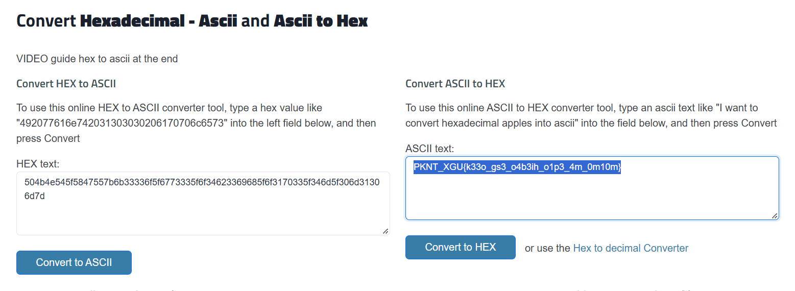
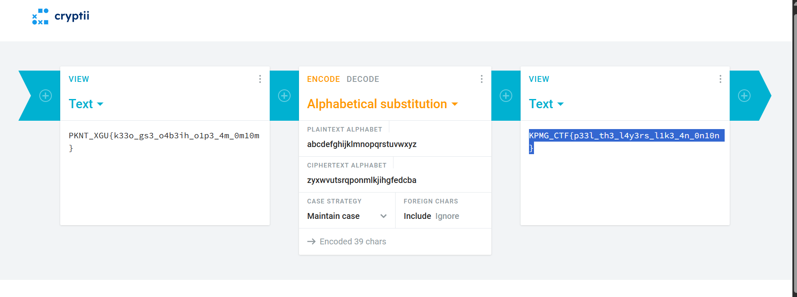

# KPMG CTF 2026: Onion — Cryptography Writeup

## Challenge Overview

| Field | Details |
| :--- | :--- |
| **Challenge Name** | Onion |
| **Category** | Cryptography / Multi-Layer Encoding |
| **Points** | 10 |
| **Artifact** | `chall.enc` |
| **Flag** | `KPMG_CTF{p33l_th3_l4y3rs_l1k3_4n_0n10n}` |

---

## Challenge Description

> *"Our old sysadmin loved stacking things - layer after layer, like he was trying to make you cry before you got to the middle. We found this on a decommissioned box. Peel it back."*

The challenge provides an encoded file named `chall.enc`. The challenge title "Onion" hints that the secret flag is encapsulated inside multiple successive encoding layers that must be "peeled" sequentially.



---

## How I Solved It

### Layer 1: Raw Encoded File to Binary
1. Inspected the downloaded artifact `chall.enc`.
2. Extracted the raw bytes and observed a stream of binary bits (8-bit binary octets separated by spaces):
   ```text
   01001110 01010100 01000001 00110000 01011001 01101010 01010010 01101100 ...
   ```



---

### Layer 2: Binary to ASCII (Base64 String)
1. Converted each 8-bit binary octet into its corresponding ASCII character.
2. The decoded ASCII output was an alphanumeric string ending with padding, characteristic of standard Base64:
   ```text
   NTA0YjRlNTQ1ZjU4NDc1NTdiNmIzMzMzNmY1ZjY3NzMzMzVmNmYzNDYyMzM2OTY4NWY2ZjMxNzAzMzVmMzQ2ZDVmMzA2ZDMxMzA2ZDdk
   ```



---

### Layer 3: Base64 Decoding to Hexadecimal
1. Decoded the Base64 payload.
2. The decoded output was a 78-character ASCII hexadecimal string:
   ```text
   504b4e545f5847557b6b33336f5f6773335f6f34623369685f6f3170335f346d5f306d31306d7d
   ```



---

### Layer 4: Hexadecimal to ASCII Text
1. Converted the hexadecimal pairs (e.g., `50` = `P`, `4b` = `K`, `4e` = `N`, `54` = `T`) into readable ASCII text.
2. The resulting string had the exact shape and punctuation of a CTF flag, with curly braces and underscores, but the letters were substituted:
   ```text
   PKNT_XGU{k33o_gs3_o4b3ih_o1p3_4m_0m10m}
   ```
3. Notice that `PKNT_XGU` corresponds positionally to `KPMG_CTF`. Specifically:
   - `P` (16th letter) <-> `K` (11th letter from reverse: 27 - 16 = 11 -> K)
   - `K` (11th letter) <-> `P` (16th letter)
   - `N` (14th letter) <-> `M` (13th letter)
   - `T` (20th letter) <-> `G` (7th letter)
   - `_` <-> `_`
   - `X` (24th letter) <-> `C` (3rd letter)
   - `G` (7th letter) <-> `T` (20th letter)
   - `U` (21st letter) <-> `F` (6th letter)
   This is the classic **Atbash cipher**!



---

### Layer 5: Atbash Cipher Decryption
1. Applied the Atbash cipher (reversing the alphabet: `A` <-> `Z`, `B` <-> `Y`, etc., leaving numbers and punctuation intact).
2. The substitution translated:
   ```text
   PKNT_XGU{k33o_gs3_o4b3ih_o1p3_4m_0m10m}
   ```
   into the final plaintext flag:
   ```text
   KPMG_CTF{p33l_th3_l4y3rs_l1k3_4n_0n10n}
   ```



---

## Python One-Liner Solver

We can automate the entire unwrapping pipeline in a single Python script:

```python
import base64

# Layer 2: Extracted Base64 string from binary
b64_str = "NTA0YjRlNTQ1ZjU4NDc1NTdiNmIzMzMzNmY1ZjY3NzMzMzVmNmYzNDYyMzM2OTY4NWY2ZjMxNzAzMzVmMzQ2ZDVmMzA2ZDMxMzA2ZDdk"

# Layer 3: Base64 decode to hex string
hex_str = base64.b64decode(b64_str).decode('ascii')

# Layer 4: Hex to ASCII string
intermediate = bytes.fromhex(hex_str).decode('ascii')

# Layer 5: Atbash substitution
def atbash(text):
    result = []
    for char in text:
        if 'a' <= char <= 'z':
            result.append(chr(ord('z') - (ord(char) - ord('a'))))
        elif 'A' <= char <= 'Z':
            result.append(chr(ord('Z') - (ord(char) - ord('A'))))
        else:
            result.append(char)
    return ''.join(result)

flag = atbash(intermediate)
print("Recovered Flag:", flag)
# Output: KPMG_CTF{p33l_th3_l4y3rs_l1k3_4n_0n10n}
```

---

## Final Flag
```text
KPMG_CTF{p33l_th3_l4y3rs_l1k3_4n_0n10n}
```

## Key Takeaways
- CTF crypto/encoding challenges frequently chain common representations: Binary -> Base64 -> Hexadecimal -> Classical Substitution.
- Analyzing known flag prefixes (e.g. comparing `PKNT_XGU` to `KPMG_CTF`) quickly reveals the transformation cipher.
