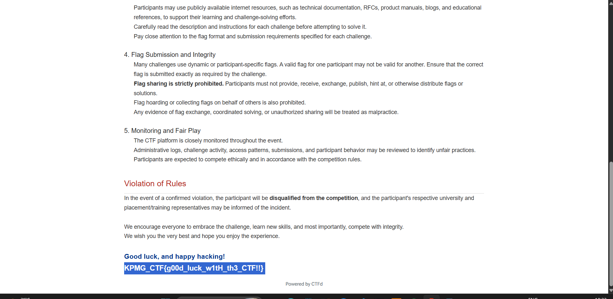
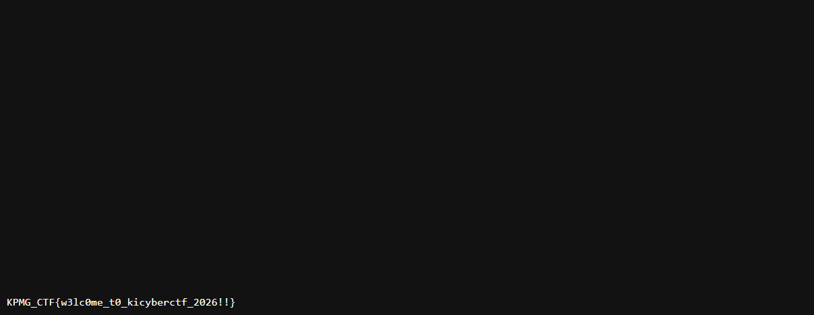

# KPMG CTF 2026: Welcome & CTF Guidelines Flags

## Challenge 1: First Flag (CTF Guidelines)

| Field | Details |
| :--- | :--- |
| **Challenge Name** | First Flag / Guidelines Flag |
| **Category** | Misc / Reconnaissance |
| **Points** | 10 |
| **Target** | CTF Platform Guidelines Page (`https://kicyber.ctfd.io/rules`) |
| **Flag** | `KPMG_CTF{g00d_luck_w1tH_th3_CTF!!}` |

### Challenge Overview
During onboarding to the KPMG CTF (KICyber CTF) platform, participants are directed to read through the official rules, code of conduct, and submission guidelines. A flag is placed directly inside the documentation as a sanity check to reward participants who thoroughly inspect the competition rules.

### How I Solved It
1. Navigated to the CTF rules/guidelines page on the CTFD instance.
2. Read through the rules regarding fair play, monitoring, flag submission integrity, and prohibited actions (flag sharing, coordinated solving).
3. Scrolled to the very bottom of the page under the "Good luck, and happy hacking!" header.
4. Highlighted the text at the footer to reveal the hidden flag string:
   ```text
   KPMG_CTF{g00d_luck_w1tH_th3_CTF!!}
   ```
5. Submitted the flag to verify the scoring engine was functional.

### Evidence


---

## Challenge 2: Welcome Flag (`robots.txt`)

| Field | Details |
| :--- | :--- |
| **Challenge Name** | Welcome Flag |
| **Category** | Web / Reconnaissance |
| **Points** | 10 |
| **Target** | `https://kicyber.ctfd.io/robots.txt` |
| **Flag** | `KPMG_CTF{w3lc0me_t0_kicyberctf_2026!!}` |

### Challenge Overview
Standard CTF web reconnaissance begins with checking well-known platform endpoints and crawler directives. The standard `robots.txt` file is used by webmasters to instruct search engines which paths should not be indexed, often exposing administrative or hidden paths in CTF challenges.

### How I Solved It
1. Checked `https://kicyber.ctfd.io/robots.txt` in the browser / via `curl`:
   ```bash
   curl -s https://kicyber.ctfd.io/robots.txt
   ```
2. Inspected the output of the robots file.
3. At the very bottom of the page, the platform authors placed the welcome flag:
   ```text
   KPMG_CTF{w3lc0me_t0_kicyberctf_2026!!}
   ```
4. Submitted the flag to confirm completion of initial platform reconnaissance.

### Evidence


---

## Key Takeaways
- Always inspect the rules, FAQs, and guidelines pages when a CTF starts.
- Always check `robots.txt`, `sitemap.xml`, and HTML source comments during initial web enumeration.
